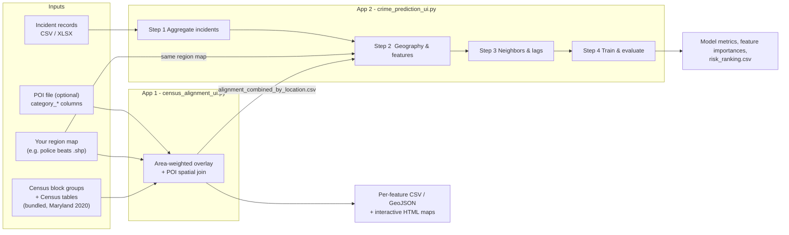
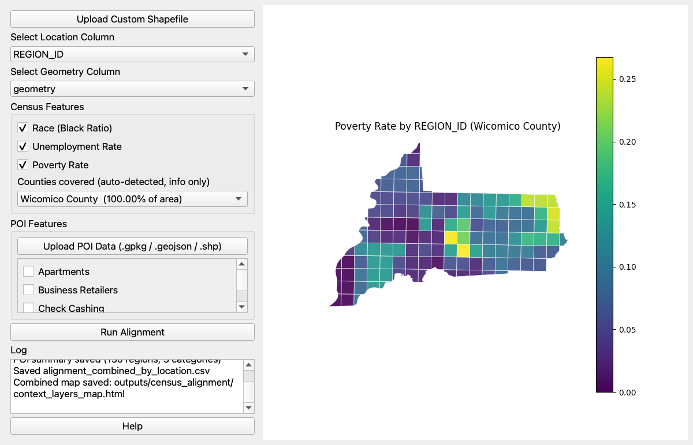
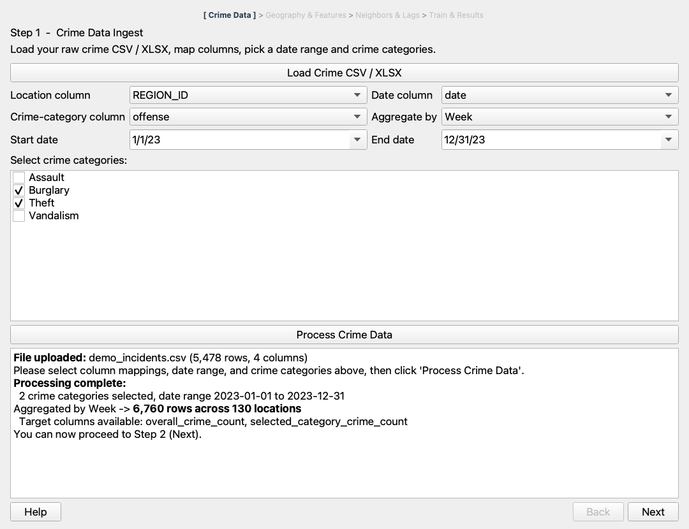
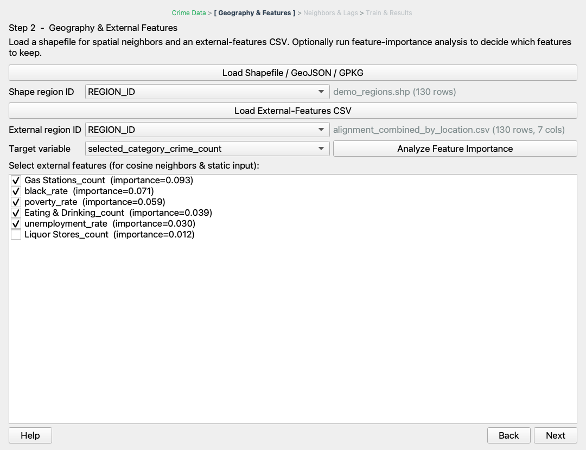
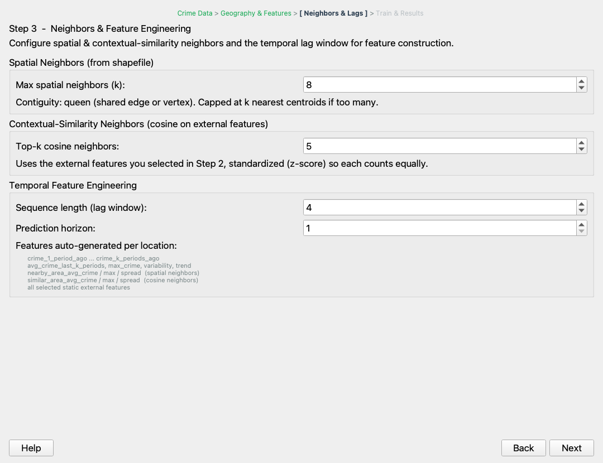
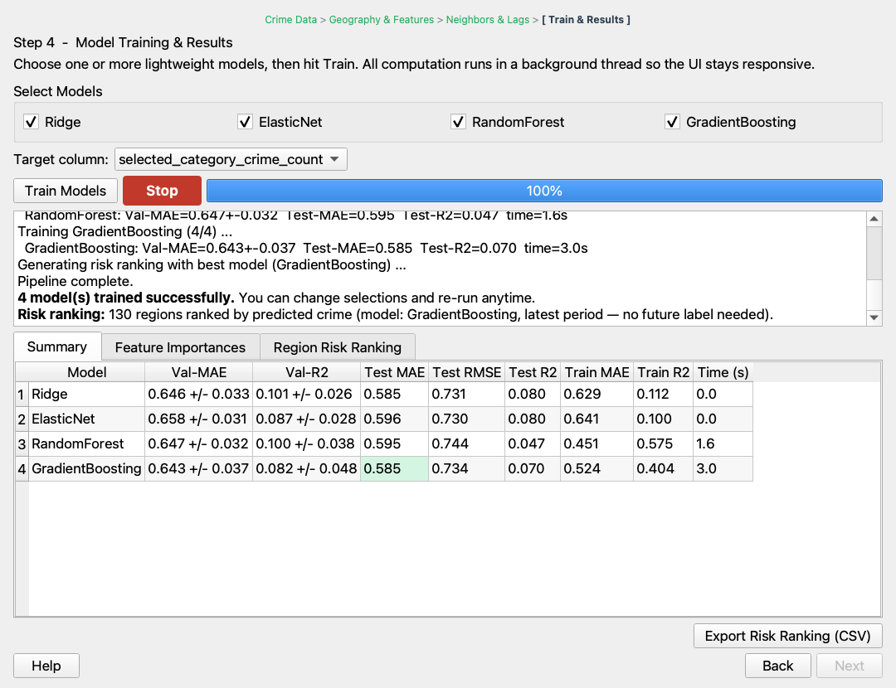
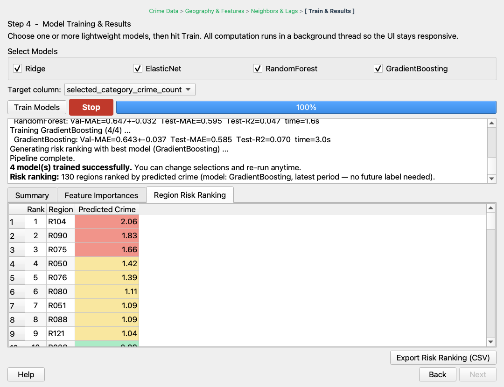

# Geospatial Analysis Platform for Crime Prediction

Two desktop applications (PyQt5) that together take you from **raw public data + raw incident records** to a **trained, evaluated crime-forecasting model and a per-region risk ranking**, all on a regular CPU:

| App | Script | What it does |
|---|---|---|
| **1. Census / POI Alignment UI** | `census_alignment_ui.py` | Re-distributes U.S. Census block-group statistics (race, unemployment, poverty) and optional Points-of-Interest counts onto *your* regions (e.g. police beats) and writes one feature table per region. |
| **2. Crime Prediction Wizard** | `crime_prediction_ui.py` | 4-step wizard: aggregates incident records into a region × time panel, adds spatial/contextual neighbor and lag features, trains up to four regression models, and ranks regions by predicted crime for the next period. |



The two apps are independent: App 1 is only needed if you want Census/POI context features in App 2. App 2 runs on crime data alone.

---

## Contents

- [Repository layout](#repository-layout)
- [Installation](#installation)
- [Quick start with the demo data](#quick-start-with-the-demo-data)
- [App 1: Census / POI Alignment UI](#app-1-census--poi-alignment-ui)
- [Helper: building a POI file from OpenStreetMap](#helper-building-a-poi-file-from-openstreetmap)
- [App 2: Crime Prediction Wizard](#app-2-crime-prediction-wizard)
- [Known limitations](#known-limitations)
- [Data sources](#data-sources)

---

## Repository layout

```
.
├── census_alignment_ui.py        # App 1
├── crime_prediction_ui.py        # App 2
├── tools/
│   └── osm_poi_extract.py        # build a POI .gpkg from an OpenStreetMap .osm.pbf
├── data/census/                  # bundled Census inputs used by App 1 (Maryland, 2020)
│   ├── tl_2020_24_bg/            #   TIGER/Line block-group shapefile
│   ├── DECENNIALPL2020.P1/       #   race (2020 Decennial, table P1)
│   ├── ACSDT5Y2020.B23025/       #   employment status (ACS 5-yr 2016-2020)
│   └── ACSDT5Y2020.B17017/       #   household poverty (ACS 5-yr 2016-2020)
├── examples/
│   ├── make_demo_data.py         # regenerates the synthetic demo data below
│   ├── demo_regions/             # 130 grid "beats" over Wicomico County, MD
│   └── demo_incidents.csv        # 5,478 synthetic incidents for 2023
├── docs/images/                  # screenshots used in this README
├── outputs/                      # created at run time (git-ignored)
├── environment.yml               # conda environment (recommended)
└── requirements.txt              # pip alternative
```

All paths are resolved **relative to the repository**, so the apps work from any working directory.

---

## Installation

### Option A: conda (recommended)

conda-forge ships matching GDAL/PROJ/Qt binaries, which avoids most geospatial install problems.

```bash
conda env create -f environment.yml
```

```bash
conda activate crime-prediction
```

> If "Solving environment" hangs on an older conda (< 23.10), use the faster solver: `conda env create -f environment.yml --solver=libmamba`. In testing, the classic solver hadn't finished after 25 minutes; libmamba took about 1 minute.

### Option B: pip / venv

Python 3.10 or newer (tested on 3.10 and 3.11).

```bash
python -m venv .venv
```

```bash
source .venv/bin/activate
```

```bash
pip install -r requirements.txt
```

**Tested on macOS (Apple Silicon) with:**
- Python 3.10, PyQt 5.15.11, geopandas 1.1.1, pandas 2.3.1, numpy 2.2.6, scikit-learn 1.7.2, folium 0.20.0, matplotlib 3.10.3
- Python 3.11, geopandas 1.2.0, pandas 3.0.6, scikit-learn 1.9.1 (a fresh `pip install -r requirements.txt` in Oct 2026)

Results are identical across both setups, apart from floating-point noise and tiny GradientBoosting differences between scikit-learn versions.

> **Linux note:** if Qt reports *"could not load the Qt platform plugin xcb"*, install your distribution's `libxcb-*` / `libxkbcommon-x11` packages.
> **POI tool only:** `tools/osm_poi_extract.py` also needs `pyrosm` (`conda install -c conda-forge pyrosm` or `pip install pyrosm`). The two apps do not.

---

## Quick start with the demo data

The repository ships a **synthetic** dataset so that you can try the full pipeline without real police data. The demo regions are a 3 km grid over Wicomico County, MD, and the incidents are random Poisson counts loosely tied to Census poverty. **These numbers are not real crime.**

```bash
python census_alignment_ui.py
```

1. **Upload Custom Shapefile** → `examples/demo_regions/demo_regions.shp`
2. Location column `REGION_ID`, geometry column `geometry`
3. Tick *Race*, *Unemployment*, *Poverty*. The county list should show *Wicomico County (100.00% of area)*.
4. **Run Alignment**. Results go to `outputs/census_alignment/`.

```bash
python crime_prediction_ui.py
```

1. **Step 1:** load `examples/demo_incidents.csv`; location `REGION_ID`, date `date`, category `offense`; aggregate by **Week**; tick a few categories → **Process Crime Data**
2. **Step 2:** load `examples/demo_regions/demo_regions.shp` and `outputs/census_alignment/alignment_combined_by_location.csv`; region ID `REGION_ID`; tick features
3. **Step 3:** keep the defaults
4. **Step 4:** **Train Models**, then **Export Risk Ranking (CSV)**

To regenerate the demo data, e.g. with a different cell size:

```bash
python examples/make_demo_data.py --cell-km 2
```

---

## App 1: Census / POI Alignment UI



### Purpose

Census statistics are published for **block groups**, but crime analysis usually happens on **other boundaries** such as police beats, patrol zones, or grid cells. This app transfers Census counts onto your regions by **area-weighted interpolation** and counts **POIs** per region. The result is a single feature table keyed by your region ID.

### Inputs

| Input | Required? | Format | Notes |
|---|---|---|---|
| Census block-group shapefile | bundled | `data/census/tl_2020_24_bg/*.shp` | Loaded automatically at start-up (all 4,079 Maryland block groups). |
| Census tables (race, unemployment, poverty) | bundled | data.census.gov CSV exports | Loaded automatically. The second header row (labels) is ignored. |
| **Your region map** | **yes** | Polygon shapefile (`.shp` + `.shx` + `.dbf` + `.prj`) | Must have a defined CRS (`.prj`); it is re-projected automatically. It needs one column that identifies the region (e.g. `BEAT`). Several polygons with the same ID are dissolved into one region. |
| POI data | optional | `.gpkg`, `.geojson`, `.json`, or `.shp` | Needs one or more **`category_<Name>` columns holding 0/1 flags**. Points and polygons are both supported. A missing CRS is assumed to be EPSG:4326. See the [POI helper](#helper-building-a-poi-file-from-openstreetmap). |

### How to run

```bash
python census_alignment_ui.py
```

All inputs and the output folder can be overridden from the command line. Use this to run with another state's data, for example:

```bash
python census_alignment_ui.py --output-dir my_results --block-groups path/to/tl_2020_XX_bg.shp --race-csv path/to/DECENNIALPL2020.P1-Data.csv --unemployment-csv path/to/ACSDT5Y2020.B23025-Data.csv --poverty-csv path/to/ACSDT5Y2020.B17017-Data.csv
```

| Option | Default |
|---|---|
| `--block-groups` | `data/census/tl_2020_24_bg/tl_2020_24_bg.shp` |
| `--race-csv` | `data/census/DECENNIALPL2020.P1/DECENNIALPL2020.P1-Data.csv` |
| `--unemployment-csv` | `data/census/ACSDT5Y2020.B23025/ACSDT5Y2020.B23025-Data.csv` |
| `--poverty-csv` | `data/census/ACSDT5Y2020.B17017/ACSDT5Y2020.B17017-Data.csv` |
| `--output-dir` | `outputs/census_alignment/` |

### Workflow in the window

1. **Upload Custom Shapefile.** The map preview switches to your regions.
2. Choose the **Location Column** (region ID) and the **Geometry Column** (normally `geometry`).
3. *(Optional)* Tick **Census Features**. No county needs to be chosen. The **Counties covered** dropdown lists the counties your regions overlap, detected from the geometry and sorted by share of area. It is for information only; see [How the numbers are computed](#how-the-numbers-are-computed).
4. *(Optional)* **Upload POI Data** and tick the categories you want.
5. **Run Alignment.** The work runs in a background thread, so the window stays responsive. The log scrolls live to the newest message, and the map canvas updates as each feature finishes. The inputs are locked until the run ends, and the window can't be closed mid-run. When the run finishes, a dialog confirms success and gives the path of the interactive map.

### How the numbers are computed

For each of your regions *r* and each Census block group *b* that it intersects:

```
w(r,b) = area(r ∩ b) / area(b)            # share of the block group that lies inside r
count(r) = Σ_b  w(r,b) · count(b)         # assumes people are spread uniformly within b
```

| Output column | Formula (per region) | Census variables |
|---|---|---|
| `black_rate` | Σw·Black alone / Σw·Total population | P1_004N / P1_001N |
| `unemployment_rate` | Σw·Unemployed / Σw·In labor force | B23025_005E / B23025_002E |
| `poverty_rate` | Σw·Households below poverty / Σw·Total households | B17017_002E / B17017_001E |
| `<Category>_count` | number of POIs with `category_<Category>=1` | POI file |

**Joining Census rows to block groups.** Each Census row is joined to its block group by the **12-digit GEOID** (state + county + tract + block group). In the CSVs this is the last 12 characters of `GEO_ID`, e.g. `1500000US240450003001` → `240450003001`. Because the GEOID is unique nationwide, a region that spans several counties automatically receives the correct values from each of them.

The **Counties covered** dropdown is computed the same way: from the first 5 digits of the GEOIDs your regions overlap, weighted by overlap area. Counties touched only by boundary slivers (< 0.01% of the area) are still used in the calculation but not listed; the log reports how many there are.

POI counting:
- **Points** belong to the region that contains them (`within` spatial join).
- **Polygons** (parks, malls, buildings) are split by area. A park that lies 30% in region A adds 0.3 to A's count. The areas are measured in the regions' UTM zone (metres). If the overlay fails, the app falls back to polygon centroids.

### Outputs (in `outputs/census_alignment/` by default)

| File | Content |
|---|---|
| `alignment_combined_by_location.csv` | **Main result.** One row per region: `<ID>, black_rate, unemployment_rate, poverty_rate, <Category>_count…`. Load this in App 2 Step 2. |
| `geometry_alignment.csv` | Overlap matrix: region × block group with `intersected_area_pb` (share of the region) and `intersected_area_bg` (share of the block group). Also includes the block group's `GEOID`. The region column is always named `police_beats`. |
| `alignment_{race,unemployment,poverty}_by_location.csv` | Per-region weighted counts and the rate. |
| `alignment_{race,unemployment,poverty}_detailed.csv` | Per region × block-group pieces before summing. |
| `alignment_{race,unemployment,poverty}_map.geojson` | Your regions with the rate attached (open in QGIS). |
| `black_ratio_map.html`, `unemployment_rate_map.html`, `poverty_rate_map.html` | Single-layer interactive maps. |
| `alignment_poi_by_location.csv` | POI counts per region. |
| `context_layers_map.html` | **Interactive map with one toggleable layer per feature.** Hover shows the values. |

Only the files for the features you ticked are written. Files with the same name are **overwritten** on every run.

### Good to know

- **Bundled data covers Maryland only.** For another state, download the same four products at block-group level (see [Data sources](#data-sources)) and pass them with the CLI options. The column codes (`P1_001N`, `P1_004N`, `B23025_002E`, `B23025_005E`, `B17017_001E`, `B17017_002E`) and the `GEO_ID` column must match. The county *name* is read from `NAME` ("Block Group 1, Census Tract 1, Allegany County, Maryland") and is used only for display. The block-group shapefile needs a `GEOID` column (`GEOID20`/`GEOID10`, or `STATEFP`+`COUNTYFP`+`TRACTCE`+`BLKGRPCE`, also work).
- **Multi-county regions** need no special handling, since values are joined per block group (GEOID). The bundled data covers every Maryland county.
- **Region IDs** may be text or numbers. They are handled as text internally, and numbers are written back unchanged, e.g. `12`.
- **Definitions:** *unemployment rate* uses the total labor force (B23025_002E, which includes Armed Forces) as the denominator. *Poverty rate* is a **household** rate (table B17017), not a person rate. The ACS values are 5-year estimates; margins of error (`…M` columns) are ignored.
- Rates are clipped to 0–1 for colouring in the HTML maps. POI layers are colored by count ÷ max count.
- The HTML maps use **Esri World Light Gray Canvas** as the basemap. It needs no API key, but viewing the maps needs an internet connection. Earlier versions used CARTO tiles, which now show *"API KEY REQUIRED"*. OpenStreetMap's own tile servers can't be used either, because they block maps opened from a local file.
- Census overlap areas are computed in the block-group CRS (geographic NAD83). Because only **area ratios** within a block group are used, the distortion is negligible. On the Salisbury police beats, poverty rates differ from a projected (UTM) calculation by less than 0.01% (relative).

---

## Helper: building a POI file from OpenStreetMap

`tools/osm_poi_extract.py` converts an OpenStreetMap extract (e.g. `maryland-latest.osm.pbf` from [Geofabrik](https://download.geofabrik.de/north-america/us/maryland.html)) into a GeoPackage that App 1 understands.

```bash
python tools/osm_poi_extract.py maryland-latest.osm.pbf maryland_poi.gpkg
```

It writes one 0/1 column per category, keeps `name` and `addr:*` columns, and saves in EPSG:4269. On the March 2026 Maryland extract it takes about 1 minute and classifies about 31,000 features.

Building areas for the *Large Retail* rule are measured in **EPSG:6487 (NAD83(2011) / Maryland, metres)**. This is accurate in Maryland; for another state, change `epsg=6487` to that state's metre-based State Plane CRS.

| Category | OSM rule |
|---|---|
| Eating & Drinking | `amenity` = restaurant, cafe, bar, pub, nightclub, fast_food |
| Check Cashing | `shop` = money_lender |
| Gas Stations | `amenity` = fuel |
| Grocery | `shop` = supermarket, convenience |
| Liquor Stores | `shop` = alcohol |
| Hotels/Motels | `tourism` = hotel, motel |
| Parks | `leisure` = park |
| Apartments | `building` = apartments |
| Shopping Malls | `shop` = mall |
| Business Retailers | `shop` = department_store, variety_store, hardware, doityourself; or `amenity` = pharmacy |
| Large Retail | `shop` = wholesale, or `building` = retail with footprint area > 2,000 m² |

Rules are checked in this order, and each feature gets only the first matching category. You can use any other POI source as long as it has `category_*` 0/1 columns.

> **POI files made with earlier versions of this script** used a wrong area unit, so *Large Retail* effectively required more than ~21,500 m². Re-run the script to get the corrected category. On Maryland it now finds 734 Large Retail features instead of 60; all other categories are unchanged.

---

## App 2: Crime Prediction Wizard

A four-page wizard. Heavy work runs on a background thread, so the window stays responsive. **Stop** cancels between steps or models.

```bash
python crime_prediction_ui.py
```

### Step 1: Crime data ingest



**Input:** a CSV/XLSX/XLS file with **one row per incident** and at least three columns:

| Column | Example | Notes |
|---|---|---|
| Location | `BEAT` = `A010` | Must use the same IDs as your region map and App 1 output (compared as text). |
| Date | `2023-04-17` | Parsed with `pandas.to_datetime(format="mixed")`. Unparseable rows are dropped. **Use date-only values; see [Known limitations](#known-limitations).** |
| Category | `offense` = `Theft` | All distinct values are listed so you can tick some of them. |

**What happens:**
- Incidents are counted per location × day.
- The panel is completed with **zero-filled** days for every location between *Start* and *End date*.
- If you chose **Week**, the days are then summed per (`year`, ISO `week`).

This produces two candidate targets:
- `overall_crime_count`: all incidents.
- `selected_category_crime_count`: only the ticked categories.

The location list contains every location that appears anywhere in the file.

> Tick the **checkboxes** in the category list. Highlighting a row without ticking it has no effect.

### Step 2: Geography & external features



| Input | Required? | Used for |
|---|---|---|
| Region map (`.shp`, `.geojson`, `.json`, `.gpkg`) + region-ID column | optional | **Spatial neighbors**. Polygons are dissolved by the ID column. |
| External-features CSV + region-ID column | optional | **Static features** and **contextual-similarity neighbors**. Usually `alignment_combined_by_location.csv` from App 1, but any per-region numeric table works. |

- **Analyze Feature Importance** ranks every numeric external column by **|Spearman correlation|** with the chosen *Target variable*. The correlation is computed on the **latest time period only** (one value per region). It is a quick screening aid, not a model-based importance. The target picked here is used only for this ranking.
- **Tick** the features you want. Only ticked features are used, both as model inputs and for the cosine-neighbor search.
- Only locations present in **all** loaded sources are modeled: crime ∩ map ∩ external CSV. The training log reports how many were dropped.

### Step 3: Neighbors & feature engineering



| Setting | Default | Meaning |
|---|---|---|
| Max spatial neighbors *k* | 8 | Queen contiguity: regions that share an edge or a corner. If there are more than *k*, the *k* nearest by centroid distance are kept. |
| Top-k cosine neighbors | 5 | The *k* regions whose ticked external-feature vectors are most similar. Each feature is first **z-scored** across regions (mean 0, standard deviation 1), then cosine similarity is computed. Every feature therefore counts equally, whatever its unit (rate vs count, fraction vs percent). Constant features are ignored. |
| Sequence length *L* | 4 | Number of past periods used for lag and rolling-window features. |
| Prediction horizon *h* | 1 | How many periods ahead the target lies. |

For each region and each period *t*, the model predicts **count(t + h)** from:

| Feature | Definition |
|---|---|
| `crime_1_period_ago` … `crime_L_period_ago` | count(t), count(t−1), …, count(t−L+1). With *h* = 1 the names are relative to the forecast period. |
| `avg/max_crime_last_L_periods`, `crime_variability_L_periods`, `crime_trend_last_L_periods` | Mean, max, standard deviation, and linear-trend slope over the last *L* periods. |
| `nearby_area_avg/max_crime`, `nearby_area_crime_spread` | Mean, max, and standard deviation of the spatial neighbors' counts at *t*. |
| `similar_area_avg/max_crime`, `similar_area_crime_spread` | The same statistics for the cosine neighbors. |
| *ticked external features* | Constant over time. |

Only information up to *t* is used, so features never peek at the target period.

### Step 4: Model training & results



| Model | Settings |
|---|---|
| Ridge | `alpha=1.0` |
| ElasticNet | `alpha=0.1, l1_ratio=0.5, max_iter=2000` |
| RandomForest | `n_estimators=200, max_depth=12, random_state=42` |
| GradientBoosting | `n_estimators=150, max_depth=4, subsample=0.8, learning_rate=0.1, random_state=42` |

**Evaluation protocol:**
1. **Chronological hold-out split.** Samples whose period index lies in the last 20% form the **test set**; everything earlier is the training set. Features are standardized with statistics from the training set only. Missing values are set to 0.
2. **Temporal cross-validation.** The training **periods** are split with `TimeSeriesSplit` into up to 5 expanding-window folds. Each fold trains on all earlier periods and validates on the next block of periods, and every region of a period is on the same side. This gives **Val-MAE** and **Val-R²** (mean ± std). The log shows e.g. *"Temporal CV: 5 folds over 39 training periods."* If there are too few periods, CV is skipped and the Val columns show `nan`.
3. **Final fit.** Each model is refit on the full training set and scored on the test set (**Test MAE / RMSE / R²**).
4. **Best model.** The model with the lowest **Test MAE** (highlighted green) produces the **Region Risk Ranking**. It predicts each region's count for the period **h steps after the last date in your range**, which has no label yet. A red *Train MAE* cell flags possible over-fitting (train MAE < ½ test MAE).

The **Feature Importances** tab lists the top 15 features per model. For trees this is the impurity importance; for linear models it is |coefficient| on standardized inputs.



**Output:** **Export Risk Ranking (CSV)** saves `rank, region, predicted_crime`. Nothing else is written to disk automatically, so copy the metrics from the Summary tab if you need them.

### Good to know

- **IDs must match exactly as text** across the incident file, the region map and the external CSV. Watch out for `101` vs `101.0` vs `0101`.
- You need at least *L + h* periods to build any sample, and a few more for the hold-out test set. If the range is too short, training stops with a message saying so. Daily aggregation over long ranges gives many samples and makes RandomForest/GradientBoosting much slower than weekly aggregation.
- You can go **Back**, change settings, and train again without restarting the app.

---

## Known limitations

These describe the **current behavior** of the code. They are intentionally not changed in this release.

1. **Timestamps with a time of day (App 2, Step 1).** Incidents are grouped by the exact timestamp and then matched against midnight dates. Rows like `2023-04-17 14:32` are therefore **silently dropped**. Convert the column to date-only values before loading.
2. **Weekly aggregation at year boundaries (App 2).** Weeks are keyed by calendar `year` + ISO `week`. Days such as 1–3 Jan 2021 (ISO week 53 of 2020) form a separate partial "week 53 of 2021" that sorts after week 52.
3. **Model selection on the test set (App 2).** The best model is chosen by Test MAE, so that number is slightly optimistic.
4. **No gap for horizons h > 1 (App 2).** Training samples just before a validation or test block have targets up to *h − 1* periods into that block. For the default *h* = 1 this does not apply.

---

## Data sources

| Path | Product | Source |
|---|---|---|
| `data/census/tl_2020_24_bg/` | 2020 TIGER/Line Shapefiles, Block Groups, Maryland (FIPS 24) | U.S. Census Bureau, https://www.census.gov/geographies/mapping-files/time-series/geo/tiger-line-file.2020.html |
| `data/census/DECENNIALPL2020.P1/` | 2020 Decennial Census Redistricting Data (P.L. 94-171), Table P1 *Race* | https://data.census.gov |
| `data/census/ACSDT5Y2020.B23025/` | ACS 5-Year Estimates 2016–2020, Table B23025 *Employment Status for the Population 16 Years and Over* | https://data.census.gov |
| `data/census/ACSDT5Y2020.B17017/` | ACS 5-Year Estimates 2016–2020, Table B17017 *Poverty Status in the Past 12 Months by Household Type by Age of Householder* | https://data.census.gov |
| POI (not bundled) | OpenStreetMap contributors, ODbL | https://www.openstreetmap.org/copyright |
| `examples/` | Synthetic, generated by `examples/make_demo_data.py` | — |

Census Bureau data products are in the public domain. Each Census folder keeps its `Column-Metadata.csv` and `Table-Notes.txt` for reference.
